**English** | [简体中文](./README.md)

<picture>
  <source media="(prefers-color-scheme: dark)" srcset="./assets/hero-dark.svg">
  
</picture>

<p align="center">
  
  
  
  
  
  
</p>

<h1 align="center">second-edit</h1>

<p align="center">
  
</p>

**An edit contract for the coding agent working on your game art.** It changes the region you name, and hands back a verifiable receipt proving that every pixel outside that region is byte-identical and that the pivot, scale, collision bounds and atlas region the scene declares are unchanged. If it cannot prove that, it writes nothing.

Nobody complains about the first generated asset. The complaint is the second one — "same thing, but the helmet is red and the sword is shorter." Today the only available operation is regenerate-and-compare, so the agent's second edit becomes another roll of the dice. second-edit turns that step into a transaction: a patch goes in, a file is written when every check passes, and the edit is refused when one does not.

## The result in 30 seconds

Two accepted edits (the second chains onto the first) and one refusal, real output:

```console
$ second-edit init hero.png --scene hero.tscn -o hero.asset.json
wrote hero.asset.json · engine godot-4 · 2 regions · source hero.png (96x96)

$ second-edit apply --asset hero.asset.json --region helmet --patch helmet.png --out hero.v2.png
changed 476 px (5.2%) · all inside region "helmet"
untouched region sha256 da02276a36a6… unchanged
pivot ok · scale ok · collision ok · atlas unchanged
wrote hero.v2.png + receipts/0001.json (exit 0)

$ second-edit apply --asset hero.v2.asset.json --region sword --patch sword.png --out hero.v3.png
changed 288 px (3.1%) · all inside region "sword"
untouched region sha256 29a588568bf9… unchanged
pivot ok · scale ok · collision ok · atlas unchanged
wrote hero.v3.png + receipts/0002.json (exit 0)

$ second-edit apply --asset hero.v3.asset.json --region helmet --patch sloppy.png --out hero.v4.png
REJECT OUT_OF_REGION: 1 px at (71, 25) outside "helmet"
no file written (exit 1)

$ second-edit check --asset hero.v3.asset.json
check PASS · source ok · pivot ok · scale ok · collision ok · atlas unchanged
receipt chain ok (2 receipts)
```

This is the recorded session in `assets/demo.cast` — replay it with `asciinema play assets/demo.cast`. `assets/demo.tape` drives the same path and re-renders it as a GIF with `vhs assets/demo.tape`.

The `untouched region sha256 … unchanged` line is the point. Not "I tried to stay inside the region", but a separate SHA-256 over the pixel set outside it: a mask makes a promise, a hash is a proof. The second edit writes `hero.v3.png` + `receipts/0002.json`, with `parent_receipt` `0001` and a `before_sha` equal to the first edit's `after_sha`. On a refusal no PNG, no sidecar and no receipt appear, so retrying cannot pollute the directory.

## Quickstart (under 10 minutes)

Go 1.24 required. The runtime uses the standard library only.

```bash
git clone https://github.com/SuperMarioYL/second-edit.git
cd second-edit
go build -o bin/second-edit ./cmd/second-edit

# Generate the sample asset: a 96x96 sheet, its scene, two good patches (helmet, sword), one bad one
mkdir -p /tmp/second-edit-demo
go run ./testdata/hero/make_fixture.go -out /tmp/second-edit-demo

# 1) Read the PNG and the Godot scene, write the contract
bin/second-edit init /tmp/second-edit-demo/hero.png \
  --scene /tmp/second-edit-demo/hero.tscn \
  -o /tmp/second-edit-demo/hero.asset.json

# 2) First edit: the helmet region
bin/second-edit apply --asset /tmp/second-edit-demo/hero.asset.json \
  --region helmet --patch /tmp/second-edit-demo/helmet.png \
  --out /tmp/second-edit-demo/hero.v2.png

# 3) Second edit: the sword region, chained onto the previous receipt (0002 / parent_receipt 0001)
bin/second-edit apply --asset /tmp/second-edit-demo/hero.v2.asset.json \
  --region sword --patch /tmp/second-edit-demo/sword.png \
  --out /tmp/second-edit-demo/hero.v3.png

# 4) Back to the helmet with a patch that crosses the boundary (refused, nothing written)
bin/second-edit apply --asset /tmp/second-edit-demo/hero.v3.asset.json \
  --region helmet --patch /tmp/second-edit-demo/sloppy.png \
  --out /tmp/second-edit-demo/hero.v4.png

# 5) No edit: validate the current source, the import facts and the receipt chain (the CI step)
bin/second-edit check --asset /tmp/second-edit-demo/hero.v3.asset.json
```

`init` is idempotent: the same PNG and scene produce byte-identical sidecars across runs, and a test locks that. A scene that cannot be mapped exits 2 with `NO_ENGINE_FACTS` and writes nothing.

## Commands

| Command | What it does | Exit codes |
| --- | --- | --- |
| `second-edit init <sprite.png> --scene <scene.tscn> [-o contract.json]` | Read the sprite and scene, write the asset contract | 0 written / 2 cannot map |
| `second-edit apply --asset <contract.json> --region <name> --patch <patch.png> --out <file.png>` | Composite one region and write only when everything passes | 0 PASS / 1 REJECT / 2 usage or contract error |
| `second-edit check --asset <contract.json> [--scene <scene.tscn>]` | Validate the source file, the four import facts and the receipt chain without editing | 0 PASS / 1 REJECT |
| `second-edit version` | Print the version | 0 |

Useful flags:

- `--json` puts schema v1 JSON on stdout and the human lines on stderr, for both `apply` and `check`, ready for an agent to pipe through `jq`.
- `--feather N` excludes N pixels around the region from the untouched hash, for accepts with a naturally feathered edge. Default 0.
- `--scene` (check only) overrides the scene recorded in the contract to validate the same facts against another `.tscn`.

A refusal with `--json` prints `{"schema_version":1,"verdict":"REJECT","code":"OUT_OF_REGION",...}` and still exits 1.

What `check` verifies: the source PNG's SHA-256 and dimensions, the four import facts against the current scene, and the hash linkage of the receipt chain (the chain head must equal the current source hash). It does **not** recompute the untouched-region hash of the output file; that evidence is the `untouched_sha` `apply` wrote into the receipt, for an auditor to compare offline against the original sheet.

## The contract and the receipt

The contract is a sidecar, not the image. `init` reads the sprite reference and the fields the scene's nodes declare (not the set of fields Godot's importer reads):

```json
{
  "schema_version": 1,
  "id": "2ffb0bbbbaa6",
  "engine": "godot-4",
  "scene": "hero.tscn",
  "source": { "file": "hero.png", "sha256": "de89af8472f46fbb8ec5d98abefd923845f73fd4c2fbd9a8c71ef645f90b9325", "width": 96, "height": 96 },
  "regions": [
    {
      "name": "helmet",
      "shape": "polygon",
      "rect": { "x": 24, "y": 24, "w": 48, "h": 40 },
      "polygon": [[32,24],[64,24],[72,32],[72,56],[64,64],[32,64],[24,56],[24,32]]
    },
    {
      "name": "sword",
      "shape": "rect",
      "rect": { "x": 42, "y": 64, "w": 12, "h": 24 },
      "polygon": [[42,64],[54,64],[54,88],[42,88]]
    }
  ],
  "facts": {
    "pivot": [48, 48],
    "pixels_per_unit": 1,
    "scale": [1, 1],
    "collision": [
      { "name": "helmet", "points": [[32,24],[64,24],[72,32],[72,56],[64,64],[32,64],[24,56],[24,32]] },
      { "name": "sword", "points": [[42,64],[54,64],[54,88],[42,88]] }
    ],
    "atlas": { "sheet": "res://hero.png", "region": { "x": 0, "y": 0, "w": 96, "h": 96 } }
  },
  "invariants": [{ "kind": "max_changed_pct", "value": 10 }]
}
```

**A region is an existing `CollisionPolygon2D` from the scene.** The name comes from the node, the shape from the polygon, so the editable area is the area the game already collides with instead of a second coordinate system to maintain. `init` refuses a scene with no collider because there is no named region to edit.

Receipts chain. This is the real `receipts/0002.json` written by the demo's second (sword) edit; its `parent_receipt` points at the previous one:

```json
{
  "schema_version": 1,
  "id": "0002",
  "parent_receipt": "0001",
  "asset_id": "2ffb0bbbbaa6",
  "region": "sword",
  "before_sha": "248bf1236976f56e5a647bac379a916cb24432d20b03a68a9ab1a251b73ab621",
  "after_sha": "f4d06a4d715a05bf34a31dd48483bbafb9c1710da4c6d904ddf5cdb4adc91d08",
  "mask_area_px": 288,
  "changed_px": 288,
  "changed_pct": 3.1,
  "untouched_sha": "29a588568bf9b04993f7492a8caba1a819fa70c1cfc1312bcc1e180981e3e932",
  "checks": [
    { "name": "pivot", "status": "ok" },
    { "name": "scale", "status": "ok" },
    { "name": "collision", "status": "ok" },
    { "name": "atlas", "status": "ok" }
  ],
  "verdict": "PASS",
  "output": "hero.v3.png"
}
```

Two rules stop an unedited file from claiming to be an edit: `apply` refuses with `NO_PIXEL_CHANGE` when the patch changes nothing, and edit N's `before_sha` must equal edit N−1's `after_sha` or the result is `BROKEN_CHAIN`. Flip one byte in a receipt and the next `check` or `apply` fails. That is not a state you repair; it is what a receipt chain means.

## The four import checks

Validation reads node properties declared in the `.tscn`. It is not a re-implementation of Godot's importer: `pixels_per_unit` comes from the project's own `metadata/pixels_per_unit` key, which the importer does not read. Every code names a difference you can point at.

| Code | Trigger | How v0.1 decides |
| --- | --- | --- |
| `PIVOT_DRIFT` | The pivot computed from the scene differs from the contract | Derive the texture's top-left from `centered` + `offset`, negate it |
| `SCALE_MISMATCH` | The scene's `scale` or `metadata/pixels_per_unit` differs | Record and compare declared values; no pixel-space inference |
| `COLLISION_OUT_OF_BOUNDS` | Any collision vertex lands outside the texture bounds | Transform vertices into pixel space and compare each against the bounds |
| `ATLAS_REGION_SHIFT` | The `AtlasTexture` sheet or `region` differs from the contract | Compare the sheet path and rectangle field by field |

The four fixtures in this repository trigger those four codes, and the tests also assert that an unchanged asset is all-PASS and that each fixture reports exactly one violation.

## Architecture

<picture>
  <source media="(prefers-color-scheme: dark)" srcset="./assets/architecture-dark.svg">
  
</picture>

One binary, five packages, no daemon, no network:

| Package | The knowledge it owns |
| --- | --- |
| `cmd/second-edit` | Subcommands, flags, exit codes; orchestration only |
| `internal/contract` | Sidecar schema, source hashing, region lookup, byte-stable serialization |
| `internal/edit` | Mask rasterization, composite, complement hash, patch diff stats |
| `internal/engine/godot` | `.tscn` parsing, pixel-space facts, the four named checks |
| `internal/receipt` | Schema v1, chain verification, the four human lines |

<picture>
  <source media="(prefers-color-scheme: dark)" srcset="./assets/process-dark.svg">
  
</picture>

## Boundaries and known limits

These affect how you use it, so they are stated plainly:

- **Godot 4 and 2D PNG only.** No 3D, GLB, Unity, Unreal or GameMaker in v0.1. A validator that guesses at Unity is worse than none.
- **No patch generation.** No model calls, no API keys, no network. The patch comes from an image model, an agent's canvas or a square you painted by hand.
- **`pixels_per_unit` is not a field the importer reads.** It comes from the scene's custom `metadata/pixels_per_unit` key; v0.1 records and compares the value you declare, with no pixel-space inference.
- **Collision polygons are read as texture-pixel space relative to the sprite origin.** That is exact for this repository's fixture and for the common "collider under the sprite" layout; it is not a general transform. If your scene uses independent scaling or parent transforms, include it in an issue. The `collision` check only verifies that vertices stay inside the texture bounds; it does not compare each vertex with the points recorded in the contract.
- **One lineage per receipts directory.** Changing output directories or starting a second chain yields `BROKEN_CHAIN` by design. A broken chain cannot keep claiming "edit N".
- **v0.1 checks whole-atlas consistency**, not frame-by-frame sprite-sheet animation.
- **darwin and linux binaries only.** No Windows build, no signed installer.
- A few Godot fields (`Sprite2D.offset`/`centered`, `AtlasTexture.region`, `CollisionPolygon2D`) have no field-by-field sample on disk. The table above is the contract; reading the code beats guessing.

## Division of responsibility

| Approach | What it is good at | What it leaves out |
| --- | --- | --- |
| Image-model inpainting / region redraw | Producing pixels inside a mask, at high quality | File semantics outside the mask: no pivot, collision or atlas, and no proof the rest is unchanged |
| Fine-tuned generators | One complete asset per call | Parametric editing: every call emits a whole result, so you keep samples, not a document |
| Agent-drivable paint tools | Making brush operations programmatic and inspectable | A canvas the agent draws into; not importing an existing raster and preserving its import facts |
| **second-edit** | Region-locked patches + complement hash + four import checks + chained receipts | It does not generate pixels, do 3D, or replace your DCC pipeline |

Complementary rather than competitive: the patch can come from anywhere; second-edit owns what happens after it lands.

<picture>
  <source media="(prefers-color-scheme: dark)" srcset="./assets/integrations-dark.svg">
  
</picture>

## Pricing

The CLI is free and stays free: it is distribution, not revenue. What teams pay for is the layer that **turns a refusal into a process**:

| Plan | What you get | Price |
| --- | --- | --- |
| Community | The full CLI, JSON schema v1, the four import checks, chained receipts | Free |
| Team (for asset-store sellers and 2–4 person teams) | Godot editor panel (pick a region, read the receipt, apply) + `second-edit check` as a CI gate + email support | **¥69 / seat / month**, or **¥690 / seat / year** (about US$10 / month internationally) |

**Who pays first**: asset-store sellers with paid listings, and small teams already running CI. Their loss is concrete — a buyer tweaks one asset, the listing stops importing, and refunds and reviews follow. With `check` in CI, the PR fails and then passes, and that step has a clear budget owner.

**How it starts**: the first ten customers are invoiced by hand, not through self-serve billing. WeChat/Alipay with a written receipt in mainland China; a Stripe Payment Link internationally. One 20-minute session on your own asset: `init` maps pivot, collision and atlas; one PASS and one REJECT; wire `check` into the repo so a PR fails and then goes green.

**The honest ceiling**: this segment supports roughly 20–40 paying teams, about ¥1.4k–2.8k per month. It funds maintenance, not a company. A second engine waits until import validation is proven load-bearing rather than decorative.

## Roadmap

- **v0.1.0 (current)**: `init` / `apply` / `check` / `version`, schema v1, four import checks, chained receipts, static darwin/linux binaries, golden tests.
- **Next candidates**: the editor panel (paid tier), a GitHub Action wrapper around `check`, one multi-region atlas commit.
- **Explicitly not planned**: 3D / GLB, Windows builds, a hosted service, accounts and telemetry, batch editing and merge resolution.

One filter decides what gets built: does it make the second edit more trustworthy? If not, it is just another feature.

## Development

```bash
make ci                  # go vet + go test
go test ./...            # masks, complement hash, receipt chain, four import codes
go run ./testdata/hero/make_fixture.go -out /tmp/se   # regenerate the fixture
```

The fixture is deterministic: re-running it on the same machine produces the same bytes, which is why `testdata/hero/hero.asset.json` can be a golden file for `init`. Change `make_fixture.go` first, regenerate, then update the golden.

`assets/demo.tape` is the terminal recording script (`vhs assets/demo.tape`) and runs the same path as "The result in 30 seconds" above.

## License

<p align="center"><sub><a href="./LICENSE">MIT</a> © 2026 SuperMarioYL</sub></p>
