[English](./README.en.md) | **简体中文**

<picture>
  <source media="(prefers-color-scheme: dark)" srcset="./assets/hero-dark.svg">
  
</picture>

<p align="center">
  
  
  
  
  
  
</p>

<h1 align="center">second-edit</h1>

<p align="center">
  
</p>

**给 coding agent 用的素材编辑契约。** 它只改你指定的区域，并用一份可校验的回执证明：区域之外的像素逐字节没变，Godot 读到的 pivot、scale、碰撞多边形和图集区域也没有被破坏。改不成就什么都不写。

第一次生成的素材通常没人抱怨。抱怨的是第二次——"头盔改红，剑短一点"。现在唯一可用的操作是整张重生成再肉眼比对，于是 agent 的第二次编辑退化成再摇一次骰子。second-edit 把这一步变成事务：补丁进来，通过就写文件，不通过就拒绝。

## 30 秒看结果

一次通过的编辑，真实输出：

```console
$ second-edit apply --asset hero.asset.json --region helmet \
    --patch helmet.png --out hero.v2.png
changed 476 px (5.2%) · all inside region "helmet"
untouched region sha256 da02276a36a6… unchanged
pivot ok · scale ok · collision ok · atlas unchanged
wrote hero.v2.png + receipts/0001.json (exit 0)
```

同一份契约，换成一个越过区域边界的补丁：

```console
$ second-edit apply --asset hero.v2.asset.json --region helmet \
    --patch sloppy.png --out hero.v3.png
REJECT OUT_OF_REGION: 1 px at (71, 25) outside "helmet"
no file written (exit 1)
```

第 2 行是重点。不是"我尽量只改这块"，而是把区域之外的像素集合单独做一次 SHA-256：掩码只承诺，哈希才是证明。拒绝时连 PNG、sidecar 和回执都不会出现，重跑一次不会污染目录。

## 快速开始（10 分钟内）

需要 Go 1.24；运行时只用标准库。

```bash
git clone https://github.com/SuperMarioYL/second-edit.git
cd second-edit
go build -o bin/second-edit ./cmd/second-edit

# 生成示例素材：一张 96×96 图集、对应场景、一个好补丁、一个越界补丁
mkdir -p /tmp/second-edit-demo
go run ./testdata/hero/make_fixture.go -out /tmp/second-edit-demo

# 1) 读 PNG + Godot 场景，写出契约
bin/second-edit init /tmp/second-edit-demo/hero.png \
  --scene /tmp/second-edit-demo/hero.tscn \
  -o /tmp/second-edit-demo/hero.asset.json

# 2) 在 helmet 区域应用补丁
bin/second-edit apply --asset /tmp/second-edit-demo/hero.asset.json \
  --region helmet --patch /tmp/second-edit-demo/helmet.png \
  --out /tmp/second-edit-demo/hero.v2.png

# 3) 同一个区域，越过边界的补丁
bin/second-edit apply --asset /tmp/second-edit-demo/hero.v2.asset.json \
  --region helmet --patch /tmp/second-edit-demo/sloppy.png \
  --out /tmp/second-edit-demo/hero.v3.png

# 4) 不编辑，只校验（CI 里跑的就是这一步）
bin/second-edit check --asset /tmp/second-edit-demo/hero.v2.asset.json
```

`init` 是幂等的：同样的 PNG 与场景，两次运行产出逐字节相同的 sidecar（测试里锁了这一点）。场景无法映射时退出 2 并给出 `NO_ENGINE_FACTS`，不写任何文件。

## 命令

| 命令 | 作用 | 退出码 |
| --- | --- | --- |
| `second-edit init <sprite.png> --scene <scene.tscn> [-o contract.json]` | 读精灵与场景，写出资产契约 | 0 写出 / 2 无法映射 |
| `second-edit apply --asset <contract.json> --region <name> --patch <patch.png> --out <file.png>` | 合成一个区域的补丁，全部检查通过才写 | 0 PASS / 1 REJECT / 2 用法或契约错误 |
| `second-edit check --asset <contract.json> [--scene <scene.tscn>]` | 不编辑，只校验同上事实与回执链 | 0 PASS / 1 REJECT |
| `second-edit version` | 打印版本 | 0 |

常用参数：

- `--json`：标准输出只放 schema v1 的 JSON，人读的四行改走标准错误。适合 agent 直接 `| jq`。
- `--feather N`：把区域外扩 N 像素，这些像素从"未改动"哈希里排除，用于接受自然羽化边缘。默认 0。
- `--scene`（仅 `check`）：覆盖契约里记录的场景，用另一个 `.tscn` 校验同一份事实。

被拒绝时 `--json` 输出 `{"schema_version":1,"verdict":"REJECT","code":"OUT_OF_REGION",...}`，退出码同为 1。

## 资产契约与回执

契约是 sidecar，不是图片本身。`init` 从场景里读取引擎真正会读的字段：

```json
{
  "schema_version": 1,
  "id": "2ffb0bbbbaa6",
  "engine": "godot-4",
  "scene": "hero.tscn",
  "source": { "file": "hero.png", "sha256": "de89af84…", "width": 96, "height": 96 },
  "regions": [
    {
      "name": "helmet",
      "shape": "polygon",
      "rect": { "x": 24, "y": 24, "w": 48, "h": 40 },
      "polygon": [[32,24],[64,24],[72,32],[72,56],[64,64],[32,64],[24,56],[24,32]]
    }
  ],
  "facts": {
    "pivot": [48, 48],
    "pixels_per_unit": 1,
    "scale": [1, 1],
    "collision": [{ "name": "helmet", "points": [[32,24],[64,24]] }],
    "atlas": { "sheet": "res://hero.png", "region": { "x": 0, "y": 0, "w": 96, "h": 96 } }
  },
  "invariants": [{ "kind": "max_changed_pct", "value": 10 }]
}
```

**区域就是场景里已有的 `CollisionPolygon2D`。** 名字来自节点名，形状来自多边形；有碰撞体的地方才有可编辑区域，避免另外维护一套坐标。`init` 拒绝没有碰撞体的场景，因为没有可命名的编辑面。

回执是链式的：

```json
{
  "schema_version": 1,
  "id": "0002",
  "parent_receipt": "0001",
  "asset_id": "2ffb0bbbbaa6",
  "region": "helmet",
  "before_sha": "da02276a…",
  "after_sha": "248bf123…",
  "mask_area_px": 1792,
  "changed_px": 476,
  "changed_pct": 5.2,
  "untouched_sha": "da02276a…",
  "checks": [
    { "name": "pivot", "status": "ok" },
    { "name": "scale", "status": "ok" },
    { "name": "collision", "status": "ok" },
    { "name": "atlas", "status": "ok" }
  ],
  "verdict": "PASS",
  "output": "hero.v2.png"
}
```

两条规则让"没编辑过"无法冒充编辑：`apply` 在补丁没有改变任何像素时以 `NO_PIXEL_CHANGE` 拒绝；每次编辑的 `before_sha` 必须等于上一条回执的 `after_sha`，否则 `BROKEN_CHAIN`。因此改动回执里的一个字节，下一次 `check` 或 `apply` 就会失败——这不是可以修补的状态，而是回执链的意义。

## 导入校验的四个错误码

校验读的是 `.tscn` 里的节点属性，和 Godot 导入时读的是同一批字段。每个错误码都对应一个可以指认的差异，而不是"感觉不对"。

| 错误码 | 触发条件 | v0.1 的判定 |
| --- | --- | --- |
| `PIVOT_DRIFT` | 场景里算出的枢轴像素位置与契约不符 | `centered` + `offset` 推出纹理左上角，再取反 |
| `SCALE_MISMATCH` | 场景的 `scale` 或 `metadata/pixels_per_unit` 与契约不符 | 记录并比较声明值，不做像素换算推测 |
| `COLLISION_OUT_OF_BOUNDS` | 任一碰撞多边形顶点落到纹理尺寸之外 | 顶点变换到像素空间后逐点比较 |
| `ATLAS_REGION_SHIFT` | `AtlasTexture` 的图集或 `region` 与契约不符 | 逐字段比较图集路径与矩形 |

仓库里的四个 fixture 分别触发这四个错误码，测试会同时检查"未改动的资产必须全 PASS"和"每个 fixture 只报一个违规"。

## 架构

<picture>
  <source media="(prefers-color-scheme: dark)" srcset="./assets/architecture-dark.svg">
  
</picture>

一个二进制，五个包，没有守护进程，没有网络调用：

| 包 | 拥有的知识 |
| --- | --- |
| `cmd/second-edit` | 子命令、参数、退出码；只做编排 |
| `internal/contract` | sidecar schema、源文件哈希、区域查找、字节稳定的序列化 |
| `internal/edit` | 掩码栅格化、合成、补集哈希、补丁差异统计 |
| `internal/engine/godot` | `.tscn` 解析、像素空间事实、四个命名检查 |
| `internal/receipt` | 回执 schema v1、链验证、四行人读输出 |

<picture>
  <source media="(prefers-color-scheme: dark)" srcset="./assets/process-dark.svg">
  
</picture>

## 边界与已知限制

写在这里，因为它们会影响你怎么用：

- **只有 Godot 4 与 2D PNG。** 3D、GLB、Unity、Unreal、GameMaker 都不在 v0.1 内。用一个会猜的 Unity 校验器，比没有校验器更糟。
- **不生成补丁。** 没有模型调用、没有 API key、没有网络。补丁来自图像模型、agent 的画布或你手画的一方块。
- **碰撞多边形按"纹理像素空间、相对精灵原点"解释。** 这对本仓库的 fixture 和"碰撞体挂在精灵下"的常见布局是精确的，不是通用变换；有独立缩放或父级变换时请在 issue 里给出场景。
- **每个 receipts 目录只有一条血脉。** 换了输出目录或另起一条链都会得到 `BROKEN_CHAIN`，这是刻意的：链断了就不能再声称"这是第 N 次编辑"。
- **v0.1 只校验整张图集的一致性**，不逐帧编辑精灵表动画。
- **只发布 darwin 与 linux 二进制。** 没有 Windows 构建，也没有签名安装包。
- 部分 Godot 字段（`Sprite2D` 的 `offset`/`centered`、`AtlasTexture.region`、`CollisionPolygon2D`）没有逐条对照官方文档的落盘样本，判定规则以上表为准，读代码比猜更可靠。

## 与现有做法的分工

| 做法 | 它擅长的事 | 它不覆盖的部分 |
| --- | --- | --- |
| 图像模型的区域重绘 / inpainting | 掩码内出图，质量高 | 掩码之外是文件语义：没有 pivot、碰撞、图集，也没有"其余像素未变"的证明 |
| 微调过的生成器 | 一次产出完整资产 | 参数化编辑：每次输出整份结果，保存的是采样而非文档 |
| agent 可驱动的绘图工具 | 让画笔操作可编程、可检查 | 面向"画进去"的画布，不负责导入已有栅格并保住其导入事实 |
| **second-edit** | 区域锁定的补丁 + 补集哈希 + 四个导入检查 + 链式回执 | 不生成像素，不做 3D，不接管你的 DCC 流程 |

分工而非替代：补丁从哪里来都可以，second-edit 负责它落地之后的那一半。

<picture>
  <source media="(prefers-color-scheme: dark)" srcset="./assets/integrations-dark.svg">
  
</picture>

## 付费 / Pricing

CLI 免费，并且会一直免费——它是分发渠道，不是收入来源。付费的是**把拒绝变成团队流程**的那一层：

| 方案 | 内容 | 价格 |
| --- | --- | --- |
| Community | 完整 CLI、JSON schema v1、四个导入检查、链式回执 | 免费 |
| Team（推荐给资产商店卖家与 2–4 人团队） | Godot 编辑器面板（选区域、看回执、应用补丁）+ `second-edit check` 作为 CI 门禁 + 邮件支持 | **¥69 / 席 / 月**，或 **¥690 / 席 / 年**（国际约 US$10 / 月） |

**谁会先付钱**：有付费上架商品的资产商店卖家，以及已经跑 CI 的小团队。他们的损失是具体的——买家改一笔，上架包导入坏了，退款与差评随之而来。`check` 进 CI 后，PR 先失败再通过，这一步有明确的预算归属。

**如何开始**：前十个客户人工开票，不走自助订阅。中国大陆用微信/支付宝并附中文书面收据；海外用 Stripe Payment Link。一次 20 分钟的接入，在你的素材上做三件事：`init` 映射 pivot/碰撞/图集；跑一次 PASS 和一次 REJECT；把 `check` 接进仓库让一个 PR 失败再通过。

**诚实的上限**：这个细分市场能支撑约 20–40 个付费团队，约 ¥1.4k–2.8k / 月。它覆盖维护成本，不构成一家公司。在证明导入校验是刚需（而不是装饰）之前，不会再开第二个引擎。

## Roadmap

- **v0.1.0（当前）**：`init` / `apply` / `check` / `version`，schema v1，四个导入检查，链式回执，darwin/linux 静态二进制，golden 测试。
- **下一步候选**：编辑器面板（付费层）、`check` 的 GitHub Action 封装、图集多区域一次提交。
- **明确不做**：3D / GLB、Windows 构建、托管服务、账号与遥测、批量编辑与合并。

取舍标准只有一个：新的能力是否让"第二次编辑"更可信。不能的话，它只是又一个功能。

## 开发

```bash
make ci                  # go vet + go test
go test ./...            # 掩码、补集哈希、回执链、四个导入错误码
go run ./testdata/hero/make_fixture.go -out /tmp/se   # 重新生成 fixture
```

fixture 是确定性的：同一台机器上重复生成得到相同字节，因此 `testdata/hero/hero.asset.json` 可以作为 `init` 的 golden 文件。改 fixture 时先改 `make_fixture.go`，重新生成，再更新 golden。

`assets/demo.tape` 是终端演示的录制脚本（`vhs assets/demo.tape`），它跑的就是上面的快速开始路径。

## License

<p align="center"><sub><a href="./LICENSE">MIT</a> © 2026 SuperMarioYL</sub></p>
